# 一级标题 H1：Flora 全语法基准测试

欢迎使用 **Flora** 主题全景校准文档！本文档完整收录了 Typora（含最新 **v1.14.15**）支持的 **全部标准与扩展语法**，包括 **GitHub Alerts 警告框（1.8+）**、**````math` 数学代码块（1.9+）**、**Mermaid v11.13 全家桶 20 种图表（1.6~1.14+）**、**MathJax v4（1.13+）** 以及 **浮动编辑工具栏（1.14+）**。

> **快捷调试提示**：
> - 按 <kbd>Cmd</kbd> + <kbd>Option</kbd> + <kbd>I</kbd> 打开 DevTools，焦点在 DevTools 时按 <kbd>Cmd</kbd> + <kbd>R</kbd> 即可实时重载 CSS
> - 在菜单栏点击「视图 → 工具栏 (Toolbar)」可测试 **Typora 1.14 新增浮动编辑工具栏（`.ty-editor-toolbar`）**
> - 按 <kbd>Cmd</kbd> + <kbd>/</kbd> 可测试 **源代码模式（Source Code Mode）** 样式
> - 按 <kbd>Cmd</kbd> + <kbd>F</kbd> 可测试 **顶部搜索与替换面板（`#md-searchpanel`）** 及高亮命中（`.md-search-hit`）样式
> - 按 <kbd>F8</kbd> 可测试 **专注模式（Focus Mode，`.on-focus-mode`）** 变暗效果

[TOC]

***

## 二级标题 H2：各级标题与标题内嵌元素

### 三级标题 H3：普通三级标题与 `inline code` 及 **加粗**

#### 四级标题 H4：普通四级标题与 *斜体* 及 ==高亮==

##### 五级标题 H5：五级标题与 [超链接](https://typora.io)

###### 六级标题 H6：六级标题与 ~~删除线~~

***

## 二级标题 H2：段落与全部行内（Span）语法

### 1. 字体混排与基础行内修饰

这是一段中英文混排与数字标点基准文本：The quick brown fox jumps over the lazy dog (`0123456789` / `!= === >= -> =>`). 用于观察英文字体 `Operator Mono` 与中文字体 `Source Han Sans`（思源黑体）/ `上首方圆体` 的字号比例、字重对比以及行高（`line-height: 1.6`）的阅读舒适度。支持行尾两个空格或 `<br/>` 强制换行：<br/>这是强制换行后的第二行文本。

- **粗体（Strong）**：`**粗体文本**` 或 `__粗体文本__` → **这是加粗强调的文字内容**
- *斜体（Emphasis）*：*`斜体文本`* 或 _`斜体文本`_ → *这是斜体文字内容，English Italic Font (`Operator Mono` Book)*
- ***粗斜体（Bold & Italic）***：`***粗斜体***` → ***同时应用粗体与斜体的中英文 Mixed Text***
- ~~删除线（Strikethrough）~~：`~~删除线~~` → ~~这是一段被废弃或删除的文本~~
- <u>下划线（Underline）</u>：`<u>下划线</u>` → <u>标准 HTML 下划线标签</u> 与 <span style="border-bottom:2px dashed #db4d52;">自定义虚线下划线</span>
- ==高亮标记（Highlight / Mark）==：`==高亮文字==` → <mark>普通高亮文本</mark>、==高亮中嵌套 **粗体** 与 `行内代码` 以及 $E=mc^2$==
- `行内代码（Inline Code）`：`` `code` `` → 请将鼠标悬停在 `const theme = "flora"`、`std::vector<int>` 上检查是否因加粗发生文字跳动
- 上标（Superscript）：`X^2^` 或 `<sup>` → 幂运算 $2^{10}$ 或 X^2^、2<sup>10</sup> = 1024
- 下标（Subscript）：`H~2~O` 或 `<sub>` → 化学分子式 H~2~O、CO<sub>2</sub>
- 键盘按键（Keyboard）：`<kbd>` → 组合键 <kbd>Ctrl</kbd> + <kbd>Shift</kbd> + <kbd>P</kbd> 或 <kbd>⌘ Cmd</kbd> + <kbd>F</kbd>
- 汉字注音（Ruby Tag）：`<ruby>` → <ruby>Flora<rt>弗洛拉</rt></ruby>、<ruby>魑<rt>chī</rt>魅<rt>mèi</rt>魍<rt>wǎng</rt>魉<rt>liǎng</rt></ruby>
- 语义化行内 HTML 标签：
  - 缩略词 `<abbr>`：<abbr title="GitHub Flavored Markdown">GFM</abbr>、<abbr title="Cascading Style Sheets">CSS3</abbr>（鼠标悬停查看完整解释）
  - 插入线 `<ins>`：<ins>这是新插入的文本内容</ins>（常与 ~~删除线~~ 搭配对比）
  - 行内短引用 `<q>`：正如设计原则所言 <q>Less is more, keep it simple</q>
  - 变量与终端输出 `<var>` / `<samp>`：当输入参数 <var>max_width</var> 时，系统输出 <samp>Status: 200 OK (900px)</samp>
- Emoji 表情符号：`:smile:` `:rocket:` → 😄 🚀 🌸 🌿 🎨 💡 ✅ ⚠️ 🔥
- HTML 注释（在编辑态下显示 `.md-comment`）：<!-- 这是一段 Markdown 隐藏注释，测试 .md-comment 颜色 -->

### 2. 链接、网址与脚注系统

- **内联链接（Inline Link）**：[Typora 官方文档中心](https://support.typora.io "悬停查看 Title 提示")
- **引用式链接（Reference Link）**：[Flora GitHub 仓库][repo-link]
- **自动网址转换（Auto URL）**：<https://github.com/wnanbei/typora-theme-flora> 与邮箱 <mailto:support@typora.io>
- **文档内书签跳转（Internal Anchor）**：[点击跳转至页面底部多媒体区](#二级标题-h2：多媒体、折叠块与原生-html) | [点击跳转至一级标题](#一级标题-h1：flora-全语法基准测试)
- **本地文件链接（Typora 1.1+ 支持一键创建与锚点）**：[预览文档 Preview.md](./Preview.md)
- **脚注引用（Footnotes）**：这里引用了第一个简短脚注[^1]，以及包含代码和公式的复合脚注[^2]。

[repo-link]: https://github.com/wnanbei/typora-theme-flora "Flora 主题仓库"

[^1]: 这是第一个简短脚注内容，用于观察底部 `.footnotes-area` 与 `.reversefootnote` 返回箭头样式。
[^2]: 这是第二个复合脚注内容：包含 `inline code`、**加粗**、[链接](https://typora.io) 以及行内公式 $\alpha + \beta = \gamma$。

***

## 二级标题 H2：引用块与 GitHub 风格警告框（Typora 1.8+ 新增）

### 3. 传统引用块（Blockquotes）

> **单层引用**：野火烧不尽，春风吹又生。芳原绿野恣行事，春入遥山碧四围。

> **多层嵌套与混合元素引用**：
> 一级引用：包含 `行内代码`、[超链接](https://typora.io)、**粗体** 和 ==高亮文本==。
>
> > 二级嵌套引用：观察多层 `blockquote::before` 红色竖线的间距与对齐。
> >
> > > 三级嵌套引用：最深层级的引用块展示。

### 4. GitHub Style Alerts / Callouts（Typora 1.8+ 核心新组件）

> [!NOTE]
> **注意（Note - `.md-alert-note`）**：用于展示用户在快速浏览时也应当留意的补充信息或背景说明。观察左侧边框与 Flora `blockquote::before` 是否冲突。

> [!TIP]
> **技巧（Tip - `.md-alert-tip`）**：提供更高效的操作建议、快捷键提示或最佳实践方案。包含 `行内代码` 与 **加粗强调**。

> [!IMPORTANT]
> **重要（Important - `.md-alert-important`）**：用户顺利完成任务所必须了解的核心前提或关键配置项。

> [!WARNING]
> **警告（Warning - `.md-alert-warning`）**：存在潜在风险或兼容性问题，需要用户格外留意的操作说明。

> [!CAUTION]
> **危险/谨慎（Caution - `.md-alert-caution`）**：高风险操作提醒！可能导致数据丢失、不可逆修改或破坏性后果。

***

## 二级标题 H2：列表系统（无序 / 有序 / 任务 / 定义列表）

### 5. 多级无序与有序列表

- **无序列表（Unordered List）**
  - 一级子项：前端核心技术栈
    - 二级子项：HTML5 / CSS3 (`Flexbox` & `Grid`)
    - 二级子项：TypeScript / React / Vue
  - 一级子项：包含多段落的列表项
    这是列表项内的第二个自然段，用于测试 `li p` 的行距与缩进对齐。

1. **有序列表（Ordered List）**
   1. 二级有序列表：单一职责原则（SRP）
   2. 二级有序列表：开放封闭原则（OCP）
      1. 三级有序列表：对扩展开放，对修改关闭
         1. 四级有序列表：深层嵌套缩进测试
2. 列表混合嵌套（有序嵌无序）：
   - 混合子项 A：观察父级序号颜色（`#db4d52`）与子级圆点颜色
   - 混合子项 B：观察正文颜色（`li > *`）是否正确还原

### 6. 任务复选框列表（Task Lists）

- [x] 已完成任务：检查勾选框打勾伪元素（`input[checked]::before/after`）与删除线颜色（`.task-list-done`）
- [ ] 未完成任务：将鼠标悬停在左侧方框上测试 `input:hover` 背景色，观察方框与首行文字的垂直居中对齐（`margin-top`）
- [ ] 多级嵌套任务列表：
  - [x] 已完成子任务 A：包含 `inline code` 与 **加粗文字** 的已完成项
  - [ ] 待办子任务 B：这是一段非常长的待办任务文本，用于测试当任务列表文字超过一行发生自动折行时，左侧复选框是否依然保持在第一行顶部对齐而不会错位。

### 7. HTML 定义列表（Definition List `<dl> <dt> <dd>`）

<dl>
  <dt>Idempotent（幂等）</dt>
  <dd>无论对同一操作执行一次还是多次，所产生的影响均与执行一次完全相同。</dd>
  <dt>Symbolic Link（符号链接 / 软链接）</dt>
  <dd>一类特殊的文件，包含指向另一个文件或目录的路径引用，修改源文件即可实时反映到链接目标。</dd>
</dl>

***

## 二级标题 H2：代码块与语法高亮（Code Fences）

### 8. 多语言代码块（覆盖 `.cm-s-inner` 全部 Token 类型）

#### 8.1 Go 与 Python（常用后端/脚本语言）

```go
package main

import (
	"context"
	"fmt"
	"time"
)

// ThemeConfig 定义主题配置结构体（测试注释 .cm-comment）
type ThemeConfig struct {
	Name      string  `json:"name"`
	FontSize  float64 `json:"font_size"`
	DarkMode  bool    `json:"dark_mode"`
}

func ApplyTheme(ctx context.Context, cfg *ThemeConfig) (int, error) {
	if cfg == nil || cfg.FontSize <= 0 {
		return 0, fmt.Errorf("invalid config: %+v", cfg)
	}
	fmt.Printf("Applying %s (size=%.2frem, dark=%v)\n", cfg.Name, cfg.FontSize, cfg.DarkMode)
	return 200, nil
}
```

```python
import dataclasses
from typing import Dict, List, Optional

@dataclasses.dataclass
class ColorPalette:
    """测试字符串、装饰器、布尔值、数字与内置类型高亮"""
    primary: str = "#db4d52"
    bg_dark: str = "#181a1b"
    text_dark: str = "#abc0d0"
    opacity: float = 0.85
    is_active: bool = True

    def to_css_vars(self) -> Dict[str, str]:
        # 列表推导式与字典构建
        return {f"--{k.replace('_', '-')}": str(v) for k, v in self.__dict__.items() if v is not None}
```

#### 8.2 CSS 与 Lua（主题内专门定制了 `.cm-m-css` 与 `.cm-m-lua`）

```css
/* 专门测试 .cm-m-css.cm-variable / .cm-property / .cm-atom / .cm-builtin */
:root {
  --primary-color: #db4d52;
  --bg-color: rgb(46, 50, 53);
}

#write pre.md-fences {
  display: block !important;
  max-width: calc(100% - 20px);
  background-color: var(--bg-color);
  border-radius: 6px;
}
```

```lua
-- 专门测试 .cm-m-lua.cm-variable 语法修正
local flora = { version = "2.0.0", author = "wnanbei", count = 42 }
function flora:render(node)
    if not node or #node == 0 then
        return nil, "empty node"
    end
    return string.format("[%s] rendered %d items", self.version, self.count)
end
```

#### 8.3 JavaScript / JSON / Shell / Diff（前端与运维常用格式）

```javascript
// 测试正则、模板字符串、箭头函数、解构赋值与括号匹配
const parseTheme = async ({ name = 'flora', version = 2 } = {}) => {
  const regex = /^flora-(?:hans|dark)?(?:-debug)?\.css$/i;
  const isValid = regex.test(`${name}.css`);
  console.log(`[Theme Check] ${name} v${version}: ${isValid ? 'PASS' : 'FAIL'}`);
  return { name, version, timestamp: Date.now() };
};
```

```diff
--- a/flora-dark.css
+++ b/flora-dark.css
@@ -1,5 +1,5 @@
 :root {
-  --text-color: #333;
+  --text-color: #abc0d0;
   --primary-color: #db4d52;
 }
```

***

## 二级标题 H2：表格系统（Tables）

### 9. 表格排版、圆角与对齐方式测试

| 组件名称（左对齐 `:---`） | 支持版本（居中 `:---:`） | 优先级（右对齐 `---:`） | 内部行内样式混合测试 |
| :--- | :---: | ---: | :--- |
| **GitHub Alerts 警告框** | `v1.8.0+` | `P0 (最高)` | 包含 `> [!NOTE]` 与 ==高亮== |
| **数学公式块 ````math`** | `v1.9.0+` | `P1 (高)` | 包含行内公式 $\sum_{i=1}^n x_i$ |
| **Mermaid v11 新图表** | `v1.10.0+` | `P1 (高)` | 包含 [官方文档链接](https://support.typora.io) |
| **源代码模式适配** | `v1.0.0+` | `P2 (中)` | 包含 <kbd>Cmd</kbd> + <kbd>/</kbd> 与 ~~旧样式~~ |
| **普通文本第五行（奇数）** | `v1.12.0` | `1,024.00` | 测试奇数行（`nth-child(odd)`）背景色 |
| **普通文本第六行（偶数）** | `v1.12.0` | `2,048.50` | 测试偶数行（`nth-child(even)`）及底部圆角 |

***

## 二级标题 H2：数学公式与化学方程式（MathJax v4 — Typora 1.13+ 升级）

### 10. 行内公式、块级公式与新语法（Typora 1.9 ~ 1.13 新增）

- **标准行内公式（`$...$`）**：质能方程 $E = mc^2$，欧拉恒等式 $e^{i\pi} + 1 = 0$，高斯积分 $\int_{-\infty}^{+\infty} e^{-x^2}\,\mathrm{d}x = \sqrt{\pi}$。
- **LaTeX 括号行内公式（Typora 1.11+ 新增 `\(...\)`）**：向量内积 \(\langle \mathbf{u}, \mathbf{v} \rangle = \sum_{i=1}^n u_i v_i\)。
- **MathJax v4 双反斜杠自动换行与黑板粗体（Typora 1.13+ 新增）**：集合数域 $\mathbb{N} \subset \mathbb{Z} \subset \mathbb{Q} \subset \mathbb{R} \subset \mathbb{C}$。
- **化学方程式（`mhchem` 扩展 `\ce{...}`）**：呼吸作用 $\ce{C6H12O6 + 6O2 -> 6CO2 ^ + 6H2O}$，可逆反应 $\ce{N2 + 3H2 <=>[\text{高温、高压}][\text{催化剂}] 2NH3}$。

#### 10.1 传统 `$$...$$` 块级公式（带自动编号与矩阵）

$$
\mathcal{L}(\theta) = -\frac{1}{N} \sum_{i=1}^{N} \left[ y_i \log \hat{y}_i + (1 - y_i) \log(1 - \hat{y}_i) \right] + \lambda \|\theta\|_2^2 \tag{1}
$$

$$
\mathbf{A} = \begin{pmatrix}
a_{11} & a_{12} & \cdots & a_{1n} \\
a_{21} & a_{22} & \cdots & a_{2n} \\
\vdots & \vdots & \ddots & \vdots \\
a_{m1} & a_{m2} & \cdots & a_{mn}
\end{pmatrix}
$$

#### 10.2 新增 ````math` 代码块公式与 `\[...\]` 块级公式（Typora 1.9 ~ 1.11 新增）

```math
f(\mathbf{x}) = \frac{1}{\sqrt{(2\pi)^k |\boldsymbol{\Sigma}|}} \exp\left( -\frac{1}{2}(\mathbf{x}-\boldsymbol{\mu})^\top \boldsymbol{\Sigma}^{-1} (\mathbf{x}-\boldsymbol{\mu}) \right)
```

\[
\nabla \times \mathbf{E} = -\frac{\partial \mathbf{B}}{\partial t}, \quad \nabla \times \mathbf{B} = \mu_0 \left( \mathbf{J} + \varepsilon_0 \frac{\partial \mathbf{E}}{\partial t} \right)
\]

***

## 二级标题 H2：图表系统（Mermaid 全家桶 & Flow / Sequence）

### 11. Mermaid 经典图表

#### 11.1 流程图与子图（Flowchart & Subgraph）

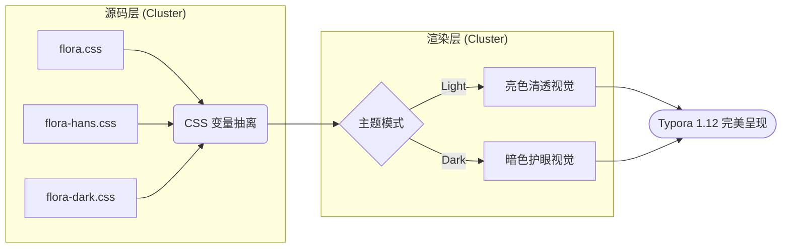

#### 11.2 时序图（Sequence Diagram）

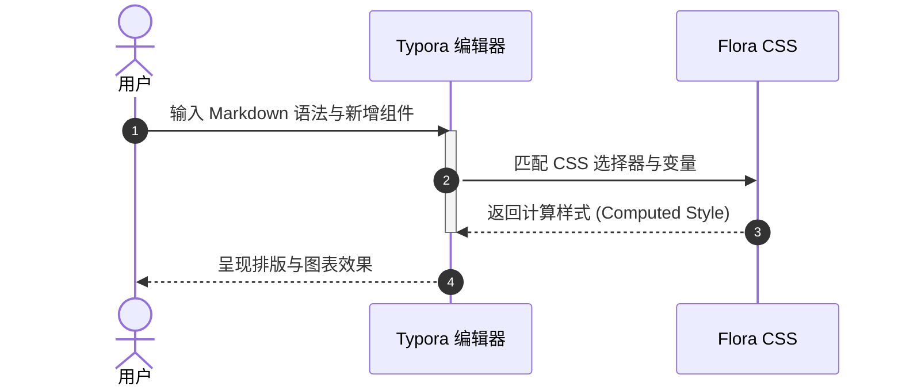

#### 11.3 甘特图（Gantt Chart — 覆盖 `.section` / `.task` / `done` / `active` / `crit`）

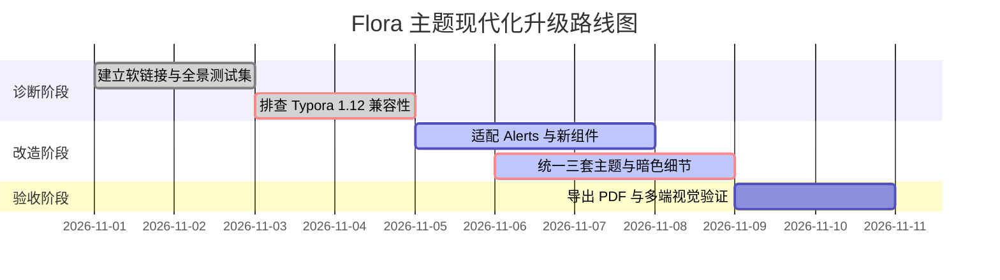

#### 11.4 类图、状态图与实体关系图（Class / State / ER）

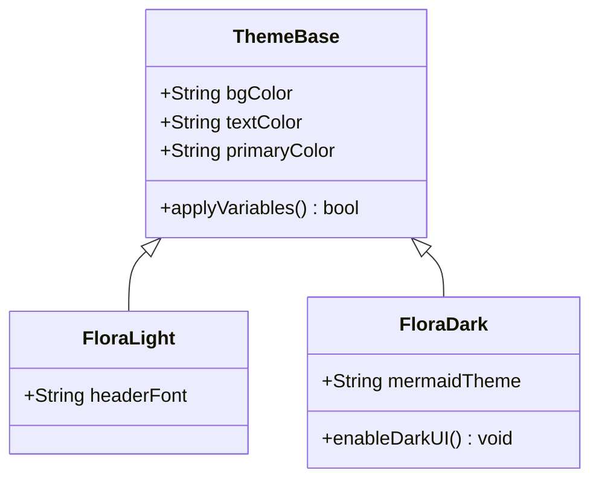

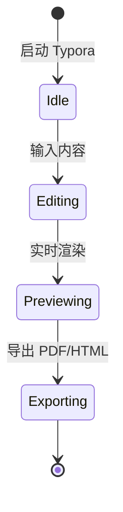

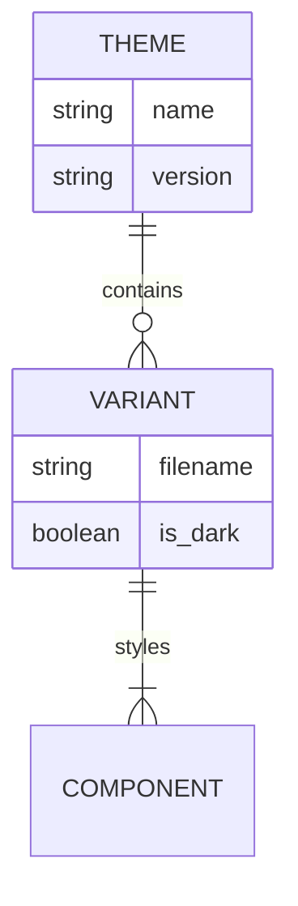

#### 11.5 饼图、思维导图、时间线、用户旅程图与 Git 分支图（Pie / Mindmap / Timeline / Journey / GitGraph）

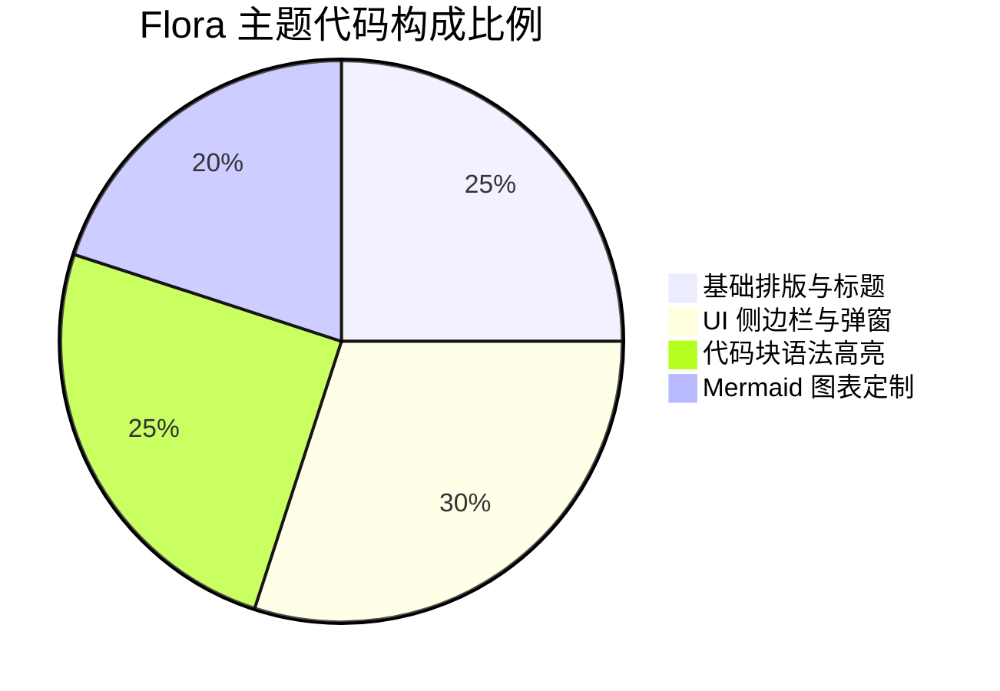

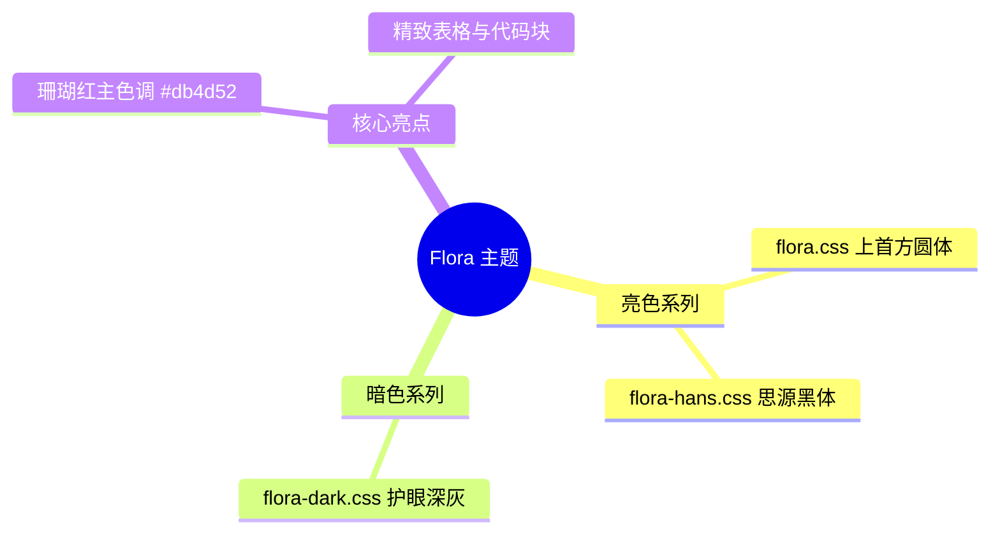

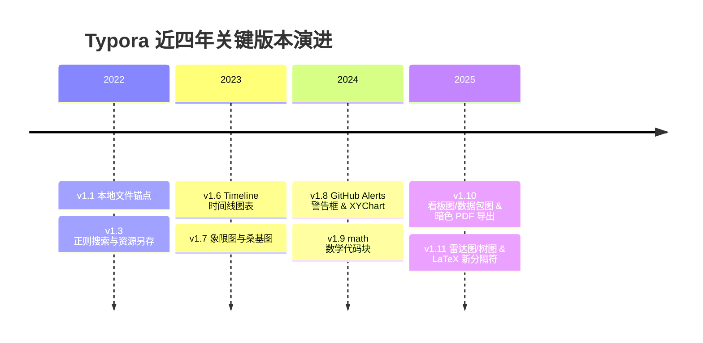

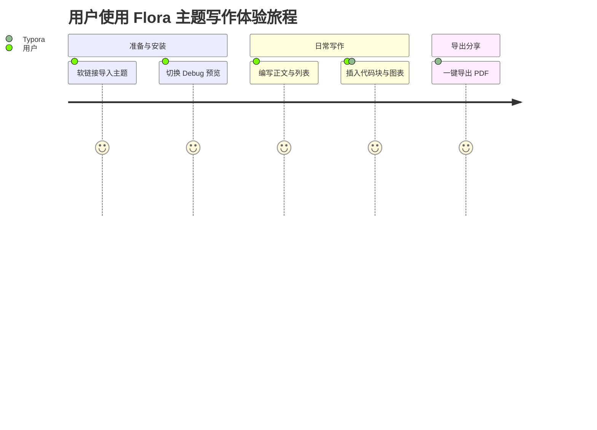

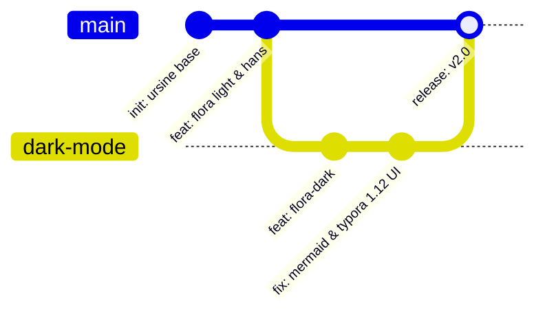

#### 11.6 象限图、桑基图、XY 图表、看板图、数据包图、雷达图与树图（Typora 1.7 ~ 1.11 新增）

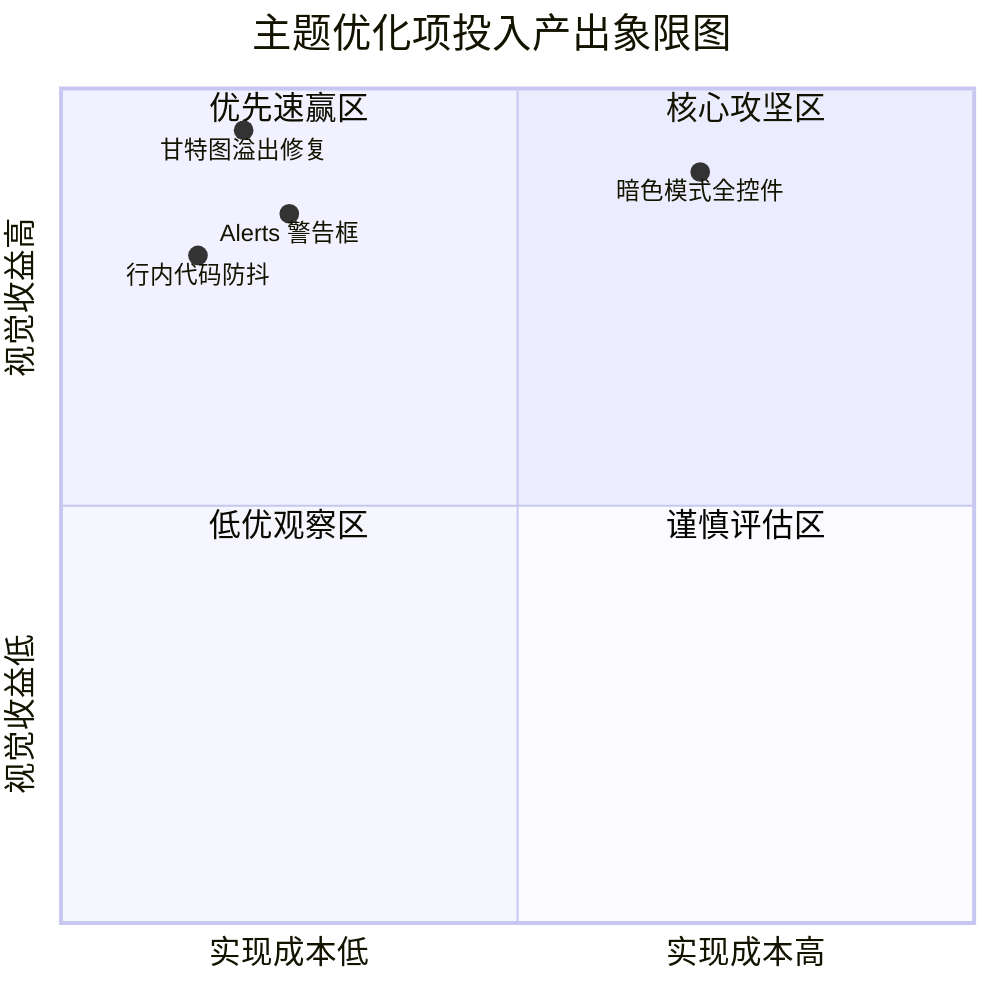

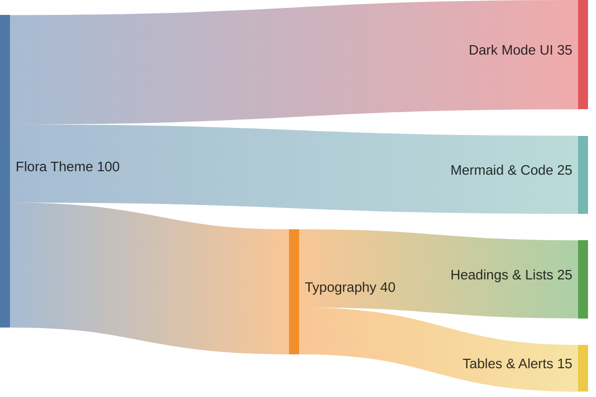

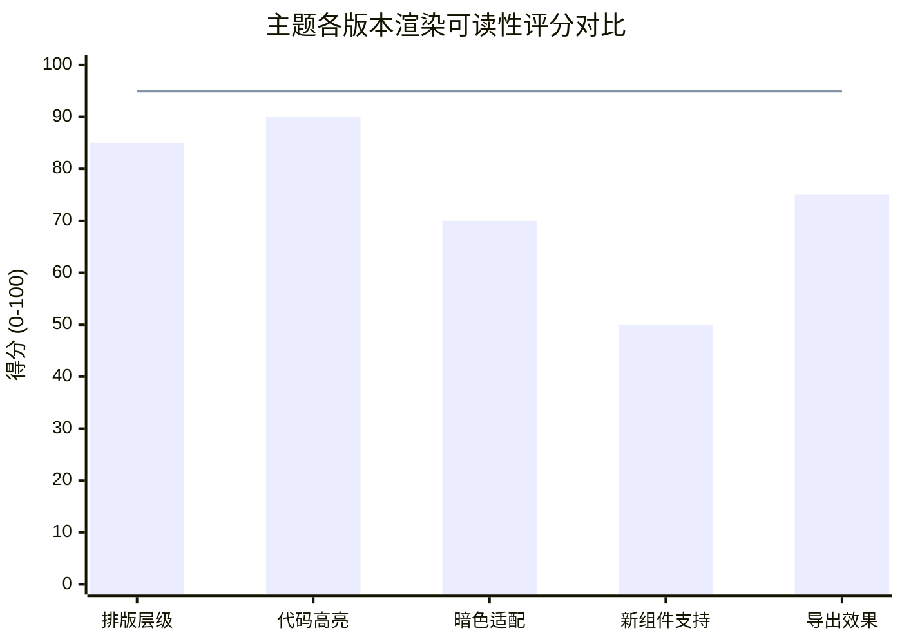

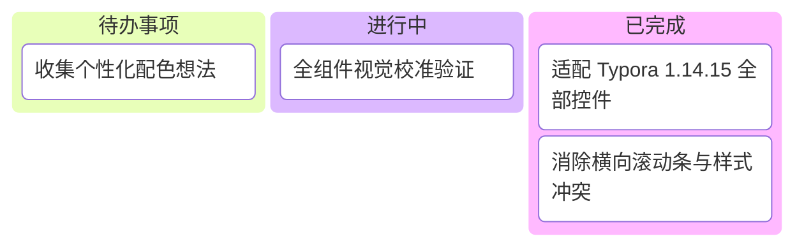

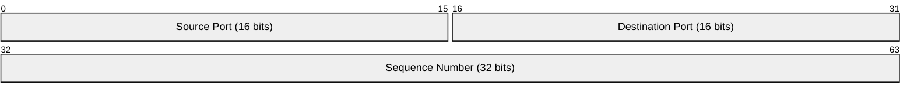

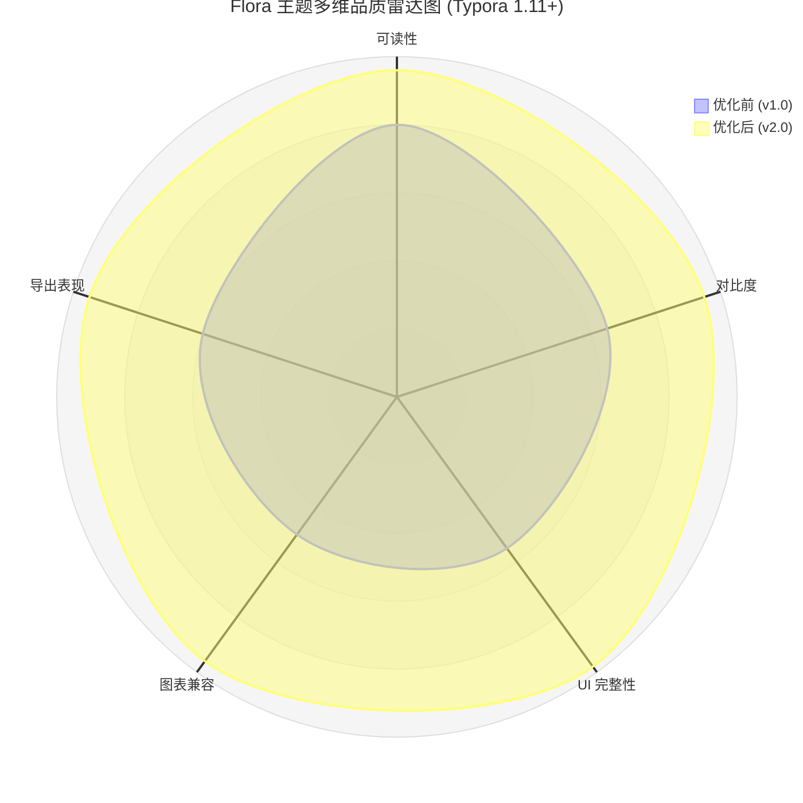

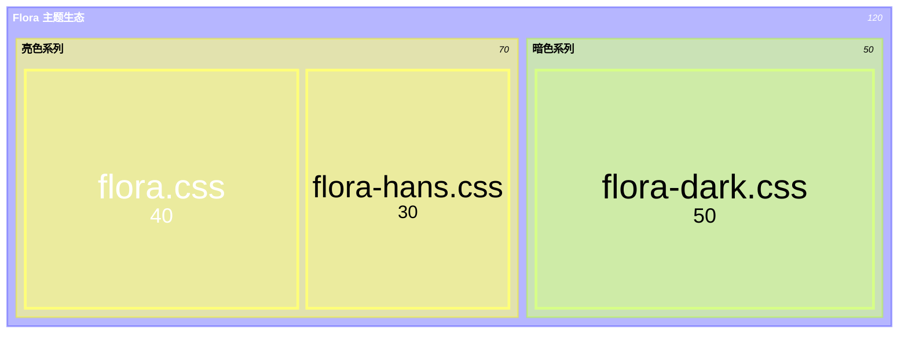

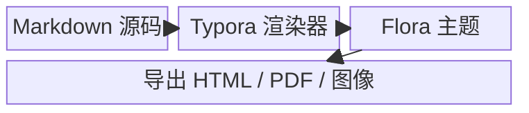

### 12. 传统 Flowchart.js 与 Sequence 图表引擎（测试 `lang="flow"` 与 `lang="sequence"`）

```flow
st=>start: 开始加载主题
op=>operation: 解析 Flora CSS
cond=>condition: 是否暗色模式?
e1=>end: 应用亮色变量
e2=>end: 应用暗色变量

st->op->cond
cond(yes)->e2
cond(no)->e1
```

```sequence
Title: 传统 Sequence 引擎渲染测试
客户端->服务端: 发起样式请求 (GET /flora.css)
Note right of 服务端: 读取本地字体与变量
服务端-->客户端: 200 OK (返回样式表)
```

***

## 二级标题 H2：多媒体、折叠块与原生 HTML

### 13. 图片、带图注 Figure、音视频控件与折叠面板

<figure>
  
  <figcaption>图 1：使用 <code>&lt;figure&gt;</code> 与 <code>&lt;figcaption&gt;</code> 渲染的居中图注效果</figcaption>
</figure>

#### 13.1 原生音频与视频播放器控件（`<audio>` & `<video>`）

<audio controls src=""></audio>

<video controls width="100%" style="max-height: 240px; border-radius: 8px; background: #000;"></video>

#### 13.2 原生折叠详情框（`<details>` & `<summary>`）

<details open>
<summary><strong>点击收起/展开 HTML 原生折叠详情框（<code>&lt;details&gt;</code> & <code>&lt;summary&gt;</code>）</strong></summary>
<p>这是折叠框内部的内容区域，包含 <code>行内代码</code>、<strong>加粗文字</strong> 以及列表：</p>
<ul>
  <li>测试折叠框在亮色/暗色主题下的边框、内边距与标题三角箭头样式</li>
  <li>测试折叠框内部的段落间距是否自然</li>
</ul>
</details>

***

## 二级标题 H2：Typora 1.14.15 交互式 UI 控件验收清单

### 14. 界面与弹窗控件检查项（无需写 Markdown，通过快捷键触发验证）

1. **侧边栏文件树与大纲（`#typora-sidebar`）**：切换左侧「文件 / 大纲」标签，测试文件树展开折叠（Issue #5253 Grid 修复）与悬停无残影（PR #12 修复），以及底部字数统计面板（`#footer-word-count-info`）。
2. **顶部搜索与替换栏（`#md-searchpanel`）**：按 <kbd>Cmd</kbd> + <kbd>F</kbd> 或 <kbd>Cmd</kbd> + <kbd>Option</kbd> + <kbd>F</kbd>，检查输入框、正则按钮、替换按钮及文档内高亮命中块（`.md-search-hit`）。
3. **源代码模式（`#typora-source`）**：按 <kbd>Cmd</kbd> + <kbd>/</kbd>，检查全屏 CodeMirror 编辑器的背景色、行号栏、选中文本背景色与光标颜色。
4. **浮动编辑工具栏（Typora 1.14+ `.ty-editor-toolbar`）**：在「视图 → 工具栏」开启后，用鼠标选中任意一段文字，检查弹出的悬浮工具栏圆角、毛玻璃阴影与按钮悬停色。
5. **偏好设置与模态框（`.ty-preferences` / `.modal-content`）**：按 <kbd>Cmd</kbd> + <kbd>,</kbd> 打开偏好设置，检查左侧导航、下拉框、开关按钮在暗色模式下的对比度。
6. **专注模式与打字机模式（<kbd>F8</kbd> / <kbd>F9</kbd>）**：开启专注模式后，检查非当前段落的柔和变暗效果（`.on-focus-mode`）。
7. **导出 PDF / HTML 预览（`@media print`）**：测试亮色与暗色主题下导出 PDF 时的背景色、代码框与图表完整性。

<p><a href="#1-字体混排与基础行内修饰">↑ 点击返回顶部「段落与行内排版样式」锚点</a></p>
